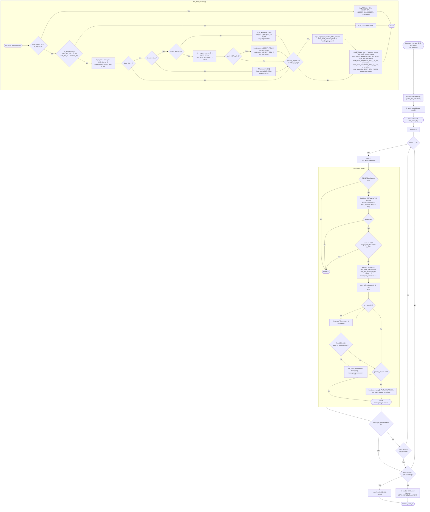

# ZMK Microchip maXTouch Driver Design (`microchip,maxtouch`)

## 1. Overview

This document describes the architecture, initialization sequence, and interrupt-driven message reporting pipeline of the Zephyr/ZMK input driver for Microchip maXTouch capacitive touch controllers ([`drivers/input/input_maxtouch.c`](drivers/input/input_maxtouch.c) and [`drivers/input/input_maxtouch.h`](drivers/input/input_maxtouch.h)).

The driver communicates with a maXTouch controller over **I2C** using 16-bit little-endian register addresses and utilizes an active-low **$\overline{\text{CHG}}$ (Change) GPIO interrupt line** to process touch and status messages asynchronously via the Zephyr system workqueue.

---

## 2. Architecture & Key Components

### 2.1 Source Files

| File | Purpose |
| :--- | :--- |
| [`drivers/input/input_maxtouch.c`](drivers/input/input_maxtouch.c) | Core driver implementation: I2C helpers, object table discovery, configuration loading, GPIO interrupt callback, workqueue draining, and Zephyr input subsystem reporting. |
| [`drivers/input/input_maxtouch.h`](drivers/input/input_maxtouch.h) | Runtime data (`struct mxt_data`), static Devicetree config (`struct mxt_config`), and packed maXTouch object register definitions (`T2`, `T5`, `T6`, `T7`, `T8`, `T25`, `T42`, `T44`, `T46`, `T47`, `T56`, `T65`, `T80`, `T100`). |
| [`dts/bindings/input/microchip,maxtouch.yaml`](dts/bindings/input/microchip,maxtouch.yaml) | Devicetree binding specification for `microchip,maxtouch`. |

### 2.2 maXTouch Object Model

Microchip maXTouch controllers expose functionality through a dynamic **Object Table** read at boot from register `0x0000` (`MXT_REG_INFORMATION_BLOCK`). Each object (`T<n>`) has a dynamically assigned 16-bit memory address, byte size, instance count, and sequential Report ID range:

| Object | Name | Role in Driver |
| :--- | :--- | :--- |
| **Info Block** | Information Block (`0x0000`) | 7-byte header containing Family ID, Variant ID, Version, Build, Matrix X/Y size, and total `num_objects`. Followed immediately by `num_objects` 6-byte object table entries. |
| **T5** | Message Processor | Output register window from which queued status and touch messages (`struct mxt_message`) are shifted out. |
| **T6** | Command Processor | Accepts device commands (`RESET`, `BACKUPNV`, `CALIBRATE` at offset `+2`) and emits status reports (e.g., `RESET`, `CAL`, `CFGERR`). |
| **T7** | Power Configuration | Configures idle (`idleacqint`) and active (`actacqint`) scan intervals, active-to-idle timeout (`actv2idleto`), and acquisition pipelining (`ACTVPIPEEN \| IDLEPIPEEN`). |
| **T8** | Acquisition Configuration | Configures capacitive sensor charge time (`chrgtime`), drift compensation, and anti-touch calibration parameters. |
| **T42** | Touch Suppression | Configures large-object/palm suppression when compiled with `MXT_ENABLE_STYLUS`. |
| **T44** | Message Count | 1-byte register immediately preceding `T5` (`T5_address - 1`) holding the number of unread messages currently queued in the `T5` FIFO. |
| **T51** | Custom / Message FIFO Gate | On devices such as the `mXT144U`, offset `+8` (`t51_custom_address + 8`) gates `T44`/`T5` I2C FIFO readout. Writing `0xFF` (specifically setting Bit 7, `0x80`) unlocks standard `T44`/`T5` message output. |
| **T100** | Multiple Touch Touchscreen | Primary touch engine. Configures object enable (`ENABLE`), reporting (`RPTEN`), close scanning (`SCANEN`), multi-touch finger count (`numtch`), vector auxiliary data (`tchaux`), and axis orientation (`SWITCHXY`, `INVERTX`, `INVERTY`, `RPTEACHCYCLE`). Emits per-finger touch reports at `report_id` offsets `t100_first_report_id + 2` through `t100_first_report_id + 2 + max_touch_points - 1`. |

---

## 3. Initialization Flow

During `POST_KERNEL` initialization (`mxt_init`), the driver performs the following steps:

1. **Bus Verification**: Verifies the I2C bus controller is ready via `i2c_is_ready_dt(&config->bus)`.
2. **Object Table Discovery (`mxt_load_object_table`)**:
   - Reads the 7-byte `mxt_information_block` at `0x0000`.
   - Iterates through all `info.num_objects` entries starting at offset `0x0007`.
   - Caches the 16-bit base addresses, object sizes (`t5_max_message_size`, `t100_size`), and base Report IDs (`t6_command_processor_report_id`, `t25_self_test_report_id`, `t100_first_report_id`) in `struct mxt_data`.
3. **GPIO & Workqueue Setup**:
   - Configures the `chg-gpios` pin as `GPIO_INPUT`, registers `mxt_gpio_cb`, initializes `data->work` with `mxt_work_cb`, and explicitly disables the `CHG` interrupt (`GPIO_INT_DISABLE`) while configuring the chip.
4. **Configuration Loading (`mxt_load_config`)**:
   - **T7 Power Config**: If present and configured in Devicetree (`has_t7_config`), performs a read-modify-write to update `idleacqint`, `actacqint`, `actv2idleto`, and enables `MXT_T7_CFG_ACTVPIPEEN | MXT_T7_CFG_IDLEPIPEEN`.
   - **T8 Acquisition Config**: If present and `charge-time` is set in Devicetree (`has_charge_time`), performs a read-modify-write on `chrgtime`.
   - **T42 Touch Suppression**: If `MXT_ENABLE_STYLUS` is defined and `T42` is present, writes default suppression thresholds.
   - **T51 FIFO Unlock**: If `T51` is present, writes `0xFF` to `t51_custom_address + 8` to unlock `T44`/`T5` FIFO reporting.
   - **T100 Touchscreen Config**: Reads the existing `T100` configuration from RAM/NVM (preserving factory tuning registers such as matrix size, pitch, range, and gains) and selectively updates `ctrl` (`ENABLE | RPTEN | SCANEN`), `numtch`, `tchaux` (`0x01`), and `cfg1` (`RPTEACHCYCLE`, `SWITCHXY`, `INVERTX`, `INVERTY`), writing back only if modified (`t100_modified`).
   - **T6 Calibrate**: Writes `0x01` to `t6_command_processor_address + 2` (`CALIBRATE`) to apply any configuration changes and re-baseline the sensor.
5. **Calibration Drain Loop**:
   - Polls `mxt_report_data(dev)` in `20 ms` intervals for up to `300 ms` until `CHG` returns to idle (`0`) and initial calibration messages have been drained.
6. **Interrupt Activation**:
   - Enables level-active interrupts (`GPIO_INT_LEVEL_ACTIVE`) on `CHG`.
   - If `CHG` is still asserted (`!= 0`), immediately disables the interrupt and submits `data->work` to prevent missing an already-active level state.

### 3.1 Initialization Flowchart

```mermaid
flowchart TD
    Start(["mxt_init(dev)"]) --> SetDev["data->dev = dev"]
    SetDev --> CheckI2C{"i2c_is_ready_dt(&config->bus)?"}
    CheckI2C -- No --> ErrI2C(["Return -EIO"])
    CheckI2C -- Yes --> LoadObjTable["Call mxt_load_object_table(dev, &info)"]

    subgraph ObjTable ["mxt_load_object_table()"]
        ReadInfo["Read MXT_REG_INFORMATION_BLOCK (0x0000)"] --> InfoOK{"Read OK?"}
        InfoOK -- No --> ObjErr(["Return error (< 0)"])
        InfoOK -- Yes --> InitLoop["report_id = 1<br/>object_addr = sizeof(info_block)<br/>i = 0"]
        InitLoop --> LoopCond{"i < info->num_objects?"}
        LoopCond -- Yes --> ReadEntry["Read mxt_object_table_element at object_addr"]
        ReadEntry --> EntryOK{"Read OK?"}
        EntryOK -- No --> ObjErr
        EntryOK -- Yes --> StoreAddr["Match obj_table.type:<br/>Store address, size, & report_id for<br/>T2, T5, T6, T7, T8, T25, T37, T42,<br/>T44, T46, T47, T51, T56, T65, T80, T100"]
        StoreAddr --> NextObj["object_addr += sizeof(obj_table)<br/>report_id += reports_per_inst * instances<br/>i++"]
        NextObj --> LoopCond
        LoopCond -- No --> ObjSuccess["Return 0"]
    end

    LoadObjTable --> ReadInfo
    ObjErr --> ErrI2C
    ObjSuccess --> ConfigGPIO["Configure CHG pin as GPIO_INPUT<br/>Init & add gpio_cb (mxt_gpio_cb)"]
    ConfigGPIO --> CheckGPIO{"gpio_add_callback OK?"}
    CheckGPIO -- No --> ErrI2C
    CheckGPIO -- Yes --> InitWork["k_work_init(&data->work, mxt_work_cb)<br/>Disable CHG pin interrupt (GPIO_INT_DISABLE)"]
    InitWork --> CheckIntDis{"Interrupt disable OK?"}
    CheckIntDis -- No --> ErrI2C
    CheckIntDis -- Yes --> CallLoadCfg["Call mxt_load_config(dev)"]

    subgraph LoadCfg ["mxt_load_config()"]
        CheckT7{"T7 addr valid &<br/>has_t7_config?"}
        CheckT7 -- Yes --> WriteT7["Read T7 -> Update idle/active acq times & timeout,<br/>set ACTVPIPEEN | IDLEPIPEEN -> Write T7"]
        CheckT7 -- No --> CheckT8
        WriteT7 --> T7OK{"Write OK?"}
        T7OK -- No --> CfgErr(["Return error (< 0)"])
        T7OK -- Yes --> CheckT8{"T8 addr valid &<br/>has_charge_time?"}

        CheckT8 -- Yes --> WriteT8["Read T8 -> Set chrgtime -> Write T8"]
        CheckT8 -- No --> CheckT42
        WriteT8 --> T8OK{"Write OK?"}
        T8OK -- No --> CfgErr
        T8OK -- Yes --> CheckT42{"MXT_ENABLE_STYLUS &<br/>T42 addr valid?"}

        CheckT42 -- Yes --> WriteT42["Write T42 touch suppression config"]
        CheckT42 -- No --> CheckT51
        WriteT42 --> T42OK{"Write OK?"}
        T42OK -- No --> CfgErr
        T42OK -- Yes --> CheckT51{"T51 addr valid?"}

        CheckT51 -- Yes --> WriteT51["Write 0xFF to T51 + 8<br/>(Unlock T44/T5 FIFO readout)"]
        CheckT51 -- No --> CheckT100
        WriteT51 --> T51OK{"Write OK?"}
        T51OK -- No --> CfgErr
        T51OK -- Yes --> CheckT100{"T100 addr valid?"}

        CheckT100 -- Yes --> ReadT100["Read T100 config (t100_len bytes)"]
        CheckT100 -- No --> CheckT6
        ReadT100 --> T100ReadOK{"Read OK?"}
        T100ReadOK -- No --> CfgErr
        T100ReadOK -- Yes --> ModT100["Ensure ENABLE | RPTEN | SCANEN,<br/>numtch, tchaux bit 0, and DT flags<br/>(repeat_each_cycle, swap_xy, invert_x/y)"]
        ModT100 --> IsT100Mod{"t100_modified?"}
        IsT100Mod -- Yes --> WriteT100["Write updated T100 config"]
        IsT100Mod -- No --> CheckT6
        WriteT100 --> T100WriteOK{"Write OK?"}
        T100WriteOK -- No --> CfgErr
        T100WriteOK -- Yes --> CheckT6{"T6 addr valid?"}

        CheckT6 -- Yes --> SendCal["Write 1 to T6 + 2 (Calibrate command)"]
        CheckT6 -- No --> CfgSuccess["Return 0"]
        SendCal --> CfgSuccess
    end

    CallLoadCfg --> CheckT7
    CfgErr --> ErrI2C
    CfgSuccess --> WaitCalCheck{"T6 addr valid?"}

    WaitCalCheck -- Yes --> InitWait["cal_wait_ms = 300"]
    InitWait --> WaitLoop{"cal_wait_ms > 0?"}
    WaitLoop -- Yes --> Sleep20["k_msleep(20)<br/>cal_wait_ms -= 20<br/>processed = mxt_report_data(dev)"]
    Sleep20 --> DrainCond{"CHG == 0 AND<br/>(processed > 0 OR cal_wait_ms <= 160)?"}
    DrainCond -- Yes --> EnableInt
    DrainCond -- No --> WaitLoop
    WaitLoop -- No --> EnableInt
    WaitCalCheck -- No --> EnableInt

    EnableInt["Configure CHG interrupt: GPIO_INT_LEVEL_ACTIVE"] --> CheckEnInt{"Interrupt enable OK?"}
    CheckEnInt -- No --> ErrI2C
    CheckEnInt -- Yes --> CheckChgActive{"CHG pin != 0<br/>(still asserted)?"}
    CheckChgActive -- Yes --> KickWork["Disable CHG interrupt (GPIO_INT_DISABLE)<br/>k_work_submit(&data->work)"]
    CheckChgActive -- No --> InitDone(["Return 0"])
    KickWork --> InitDone
```



---

## 4. Interrupt & Message Processing Routine

The maXTouch controller operates `CHG` in level-triggered mode (`T18 CTRL = 0x01`): the controller holds $\overline{\text{CHG}}$ active for as long as at least one unread message remains in the `T5` FIFO.

### 4.1 Execution Stages

1. **Hardware ISR (`mxt_gpio_cb`)**:
   - Triggered when `CHG` is asserted (`GPIO_INT_LEVEL_ACTIVE`).
   - Immediately masks the GPIO interrupt (`GPIO_INT_DISABLE`) to prevent an ISR storm while the level line remains active, then schedules `data->work` on the system workqueue.
2. **Workqueue Drain Loop (`mxt_work_cb`)**:
   - Runs up to `20` iterations of `mxt_report_data(data->dev)`.
   - Stops early if `mxt_report_data()` returns `0` (FIFO empty) or if `gpio_pin_get_dt(&config->chg) == 0` (line de-asserted).
   - After the loop, checks `CHG` one final time:
     - If `CHG == 1` (still asserted), resubmits `data->work` to yield the workqueue thread briefly before continuing to drain.
     - If `CHG == 0` (idle), re-enables the level interrupt (`GPIO_INT_LEVEL_ACTIVE`).
3. **FIFO Batch Reader (`mxt_report_data`)**:
   - Performs a single combined I2C transaction starting at `t44_message_count_address` (`1 + read_len` bytes) to read both the 1-byte `T44` queue depth (`count`) and the first `T5` message simultaneously.
   - If `count == 0` or `msg.report_id` is `0x00`/`0xFF`, returns `0`.
   - Processes the first message via `mxt_proc_message()`, then loops up to `min(count - 1, 15)` times reading subsequent messages directly from `t5_message_processor_address`.
   - Flushes any remaining pending touch state with a synchronized `INPUT_BTN_TOUCH` event (`sync = true`).
4. **Message Decoder (`mxt_proc_message`)**:
   - **T6 Status Reports**: Decodes and logs status flags (`OK`, `RESET`, `OFL`, `SIGERR`, `CAL`, `CFGERR`, `COMSERR`).
   - **T100 Touch Reports**:
     - Computes `finger_idx = msg->report_id - data->t100_first_report_id - 2`.
     - Extracts `detect` (`Bit 7`), `type` (`Bits 6:4`), and 16-bit little-endian `x_pos` and `y_pos`.
     - Tracks per-finger state (`finger_active[0..4]`, `prev_x[0..4]`, `prev_y[0..4]`):
       - On initial touch down, records the starting `(x_pos, y_pos)`.
       - On subsequent movement while detected, computes `(dx, dy)` and emits relative mouse movement events (`INPUT_REL_X`, `INPUT_REL_Y` with `sync = true`) for immediate ZMK pointer listener compatibility.
       - On release (`detect == false`), clears `finger_active[finger_idx]`.
     - Emits multi-touch absolute events (`INPUT_ABS_MT_SLOT`, `INPUT_ABS_X`, `INPUT_ABS_Y`, `INPUT_BTN_TOUCH`) and coalesces synchronization frames across fingers using `pending_fingers`.

### 4.2 Interrupt & Message Processing Flowchart



---

## 5. Devicetree Configuration Reference

The driver is instantiated for each enabled `microchip,maxtouch` node via `DT_INST_FOREACH_STATUS_OKAY(MXT_INST)`.

```dts
&i2c0 {
    status = "okay";

    maxtouch: maxtouch@4a {
        compatible = "microchip,maxtouch";
        reg = <0x4a>;
        chg-gpios = <&gpio1 0 (GPIO_ACTIVE_LOW | GPIO_PULL_UP)>;

        sensor-width = <43>;
        sensor-height = <43>;
        max-touch-points = <5>;

        /* Optional orientation flags (applied to T100 CFG1: 1=enable, 0=disable, omit=NVRAM default) */
        swap-xy = <1>;
        invert-x = <1>;
        invert-y = <0>;
        /* repeat-each-cycle = <1>; */

        /* Optional T7 Power Config overrides */
        idle-acq-time-ms = <5>;
        active-acq-time-ms = <5>;
        active-to-idle-timeout-ms = <20>;

        /* Optional T8 Acquisition Config override */
        charge-time = <12>;
    };
};
```

